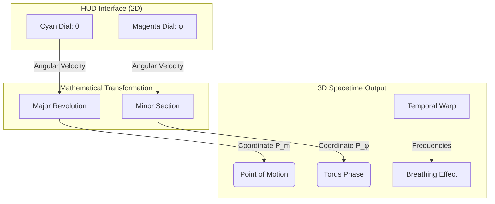

# 🌌 The Breathing Universe Portal

Interactive visualization of the fundamental architecture of reality based on **Arnon Daniel Katz's (Noni)** Breathing Universe Theorem.

## 📜 Overview
This project is a scientific visualization portal designed to explore the geometric and temporal dynamics of a toroidal universe. It translates complex mathematical theorems into an interactive 3D environment, allowing users to manipulate space-time parameters and observe the resulting quantum behaviors.

## 📐 The Geometric Diagram: Technical Relationship
The core of the visualization is built upon a **Toroidal Coordinate System**, where the relationship between the diagram and the graphical representation is defined by two primary angular dimensions:

### Visual Concepts & Mapping

### 1. The $\theta$ Dimension (Major Revolution)
- **Represented by:** The outer cyan circle in the HUD.
- **Graphic Logic:** Governs the "orbital" motion around the major axis of the torus. It represents the macro-scale revolution of the "Point of Motion" ($P_m$).
- **Interaction:** Dragging the cyan HUD pointer adjusts the angular velocity across the major radius.

### 2. The $\phi$ Dimension (Minor Section)
- **Represented by:** The inner magenta circle in the HUD.
- **Graphic Logic:** Governs the "tubular" rotation within the cross-section of the torus. It represents the micro-scale phase of the "Torus Point" ($P_\phi$).
- **Interaction:** Dragging the magenta HUD pointer adjusts the spinning speed within the torus tube.

### Toroidal Mapping Logic
The position $(X, Y, Z)$ of any point on the torus is calculated using:
- $X = (R + r \cdot \cos(\phi)) \cdot \cos(\theta)$
- $Y = (R + r \cdot \cos(\phi)) \cdot \sin(\theta)$
- $Z = r \cdot \sin(\phi)$

Where **R** is the Major Radius and **r** is the Minor Radius.

## ✨ Features
- **Neo-Euclid Theme:** A scientific aesthetic inspired by historical mathematical treatises, featuring LaTeX-style typography and parchment textures.
- **Dual Mode:** Choose between the **Manuscript Mode** (Light) for a traditional scholarly feel and **Cosmic Mode** (Dark) for immersive space exploration.
- **Interactive HUD:** Precise 270° dial controls for speed manipulation with visual feedback (dynamic stroke/scaling).
- **Quantum Tracking:** Live coordinate display for $X, Y, Z, \theta,$ and $\phi$.
- **Temporal Drive:** Play/Pause controls with variable time-warping capabilities.

## 🛠 Technical Stack
- **Three.js:** Primary 3D engine for rendering geometries and shader-based orthogonal planes.
- **CSS3 Variables:** Dynamic theme-switching engine.
- **Math Logic:** Custom mapping functions for angular velocity to linear coordinate projection.

---
*Created by Jamagax in collaboration with AI, dedicated to the exploration of the Breathing Universe.*
