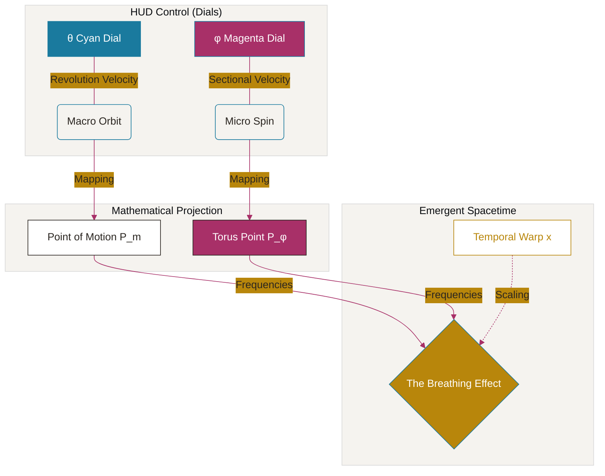

# 🌌 The Breathing Universe Portal

Interactive visualization of the fundamental architecture of reality based on **Arnon Daniel Katz's (Noni)** Breathing Universe Theorem.

## 📜 Overview
This project is a scientific visualization portal designed to explore the geometric and temporal dynamics of a toroidal universe. It translates complex mathematical theorems into an interactive 3D environment, allowing users to manipulate space-time parameters and observe the resulting quantum behaviors.

## 📐 Geometric Mapping & Concept Relationships

Using the **Neo-Euclid** framework, the portal maps HUD (2D) interactions to Toroidal (3D) coordinates.

### The conceptual framework:

---

### 1. The $\theta$ Dimension (Major Axis)
*Represented by the outer cyan circle.*
- **Coordinate:** $Orbit_{\theta}$
- **Motion:** Orbital path around the central singularity of the torus.
- **Physics:** Represents the macro-scale revolution of energy ($P_m$).

### 2. The $\phi$ Dimension (Minor Axis)
*Represented by the inner magenta circle.*
- **Coordinate:** $Section_{\phi}$
- **Motion:** Centrifugal spin within the torus tube cross-section.
- **Physics:** Represents the micro-scale phase/wave state ($P_\phi$).

---

## 🔬 Toroidal Mathematics

The graphical projection follows the parametric equations for a Torus:

$$
\begin{cases} 
x = (R + r \cos \phi) \cos \theta \\
y = (R + r \cos \phi) \sin \theta \\
z = r \sin \phi 
\end{cases}
$$

Where:
- $R$: Major Radius (distance from center to tube center).
- $r$: Minor Radius (thickness of the tube).
- $\theta \in [0, 2\pi]$ (controlled by the Cyan HUD Dial).
- $\phi \in [0, 2\pi]$ (controlled by the Magenta HUD Dial).

## ✨ Features
- **Neo-Euclid Theme:** A scientific aesthetic inspired by historical mathematical treatises.
- **Dual Mode:** Choose between **Manuscript Mode** (Light) and **Cosmic Mode** (Dark).
- **Interactive HUD:** Precise 270° dial controls with dynamic stroke and scaling.
- **Temporal Drive:** Play/Pause controls with variable time-warping ($Warp_x$).

## 🛠 Technical Stack
- **Three.js:** Primary 3D engine.
- **Mermaid.js:** Concept diagramming.
- **LaTeX:** Mathematical notation.

---
*Created by Jamagax in collaboration with AI, dedicated to the exploration of the Breathing Universe.*
